<div align="center">

  

  # 🎮 ChimuCheck
  ### *El Ecosistema Gaming Definitivo: Torneos, Sorteos, Comunidad y Economía Gamificada*

  [](https://nextjs.org/)
  [](https://react.dev/)
  [](https://www.typescriptlang.org/)
  [](https://tailwindcss.com/)
  [](https://www.prisma.io/)
  [](https://authjs.dev/)

  <p align="center">
    <strong>Plataforma web integral de torneos esports, sorteos en tiempo real con ruleta interactiva, concursos de votación y fidelización comunitaria a través de la moneda virtual ChimuCoins.</strong>
  </p>

</div>

---

## 📌 Tabla de Contenidos

1. [¿De qué trata ChimuCheck?](#-de-qué-trata-chimucheck)
2. [Público Objetivo](#-público-objetivo)
3. [Características Principales](#-características-principales)
4. [Galería de Pantallas Reales](#-galería-de-pantallas-reales)
   - [Portal Público y Jugadores](#-portal-público-y-jugadores)
   - [Panel de Super Administrador](#-panel-de-super-administrador)
5. [Arquitectura y Stack Tecnológico](#-arquitectura-y-stack-tecnológico)
6. [Guía de Instalación y Ejecución Local](#-guía-de-instalación-y-ejecución-local)
7. [Despliegue con Docker](#-despliegue-con-docker)
8. [Variables de Entorno](#-variables-de-entorno)
9. [Autor y Contacto](#-autor-y-contacto)

---

## 💡 ¿De qué trata ChimuCheck?

**ChimuCheck** es una solución web integral diseñada para potenciar la interacción entre **streamers / creadores de contenido gaming y su comunidad**. El sistema transforma la experiencia pasiva de un espectador en una **experiencia interactiva y competitiva** con recompensas tangibles.

El proyecto centraliza:
- 🏆 **Competencias y Torneos:** Registro, llaves, puntuaciones y podios automatizados para títulos como *Mortal Kombat 1*, *Fortnite*, *FIFA 26*, *Sonic Racing*, *Dragon Ball Sparking Zero* y más.
- 🪙 **Economía Virtual (ChimuCoins):** Los jugadores acumulan monedas virtuales al competir, ganar partidas y participar en actividades, las cuales pueden canjear en la tienda oficial por merchandising exclusivo (gorras, tazas, remeras, etc.) o periféricos gamers.
- 🎁 **Sorteos Interactivos con Múltiples Premios:** Sistema de sorteos con inscripciones abiertas o por requisitos, visualización de puestos (1º, 2º, 3º, etc.) y ejecución de ruletas animadas en vivo para transmisiones de streaming.
- 🗳️ **Concursos de Votación Comunitaria:** Módulo donde los usuarios envían sus participaciones (artes, fotos, clips) con su usuario de Instagram para que la comunidad vote de forma transparente.
- 📊 **Panel Super Admin:** Un centro de comando para gestionar jugadores, balances de ChimuCoins, catálogo de premios, secciones del home, carruseles de banners y métricas operativas en tiempo real.

---

## 🎯 Público Objetivo

ChimuCheck fue concebido para resolver las necesidades de diversos perfiles del ecosistema digital:

| Público | Beneficios en ChimuCheck |
| :--- | :--- |
| **🎮 Gamers & Jugadores Competitivos** | Inscripción rápida a torneos, seguimiento de estadísticas individuales por categoría (*Shooter, Kombat, Racing, Sports, Board Games*), ranking general con medallas y canje de premios reales. |
| **📺 Comunidad de Espectadores & Fans** | Participación directa en los sorteos en vivo durante directos de Twitch / YouTube / Kick, votaciones en concursos comunitarios y seguimiento de directos. |
| **🎙️ Streamers & Creadores de Contenido** | Herramienta todo-en-uno para fidelizar a la audiencia, evitar fraudes en sorteos con sistemas de *cooldown* y gestionar torneos sin depender de múltiples hojas de cálculo o bots dispersos. |
| **🏢 Patrocinadores & Organizadores de Esports** | Visibilidad de marca mediante banners dinámicos, entrega transparente de premios físicos y métricas claras de participación activa. |

---

## ⚡ Características Principales

### 🌟 Para el Jugador / Usuario Común
- **Inicio de Sesión Social (OAuth):** Acceso rápido con Google, Discord, Twitch, X (Twitter) o Facebook, además de registro tradicional por correo.
- **Perfil Gamificado:** Visualización de avatar, alias, balance de ChimuCoins, ratio de victorias (*Win Rate*) y estadísticas desglosadas por categoría de juego.
- **Leaderboard / Ranking Global:** Podio destacado en el banner principal con insignias Oro, Plata y Bronce para los mejores clasificados.
- **Cartelera de Torneos:** Visualización de torneos disponibles, formatos (1v1, escuadras), cupos en tiempo real, reglas y estado de inscripción.
- **Sorteos Transparentes:** Ficha detallada de cada sorteo con cuenta regresiva, galería fotográfica de los premios y lista de participantes verificados.
- **Tienda de Premios:** Catálogo de productos físicos y digitales canjeables por ChimuCoins con cálculo de costo y estado de stock.

### 🛡️ Para el Administrador (Super Admin)
- **Dashboard con Analítica:** Gráficos de altas semanales, distribución de premios, total de ChimuCoins en circulación y alertas en tiempo real.
- **Gestión Integral de Torneos:** Creación de torneos con fechas automáticas, cupos máximos, selección de juegos y formatos, carga de podios y asignación automática de puntos.
- **Sorteos en Vivo:** Botón "En Vivo" para sortear participantes con efectos visuales durante el stream, con control anti-repetición y margen de días configurables (*cooldown*).
- **Gestión y Moderación de Jugadores:** Aprobación de solicitudes de registro, edición manual de ChimuCoins, reseteo de estadísticas y suspensión de usuarios.
- **CMS de Secciones y Banners:** Control total del contenido de la landing page, links de redes sociales, carruseles de banners con control de intervalos en segundos y editor de la sección "Historia".

---

## 📸 Galería de Pantallas Reales

A continuación se presentan capturas tomadas directamente de la plataforma en funcionamiento:

### 🌟 Portal Público y Jugadores

#### 1. Landing Page y Banner Principal
> Portada inmersiva con temática gamer, navegación fluida, streaming hub y carrusel dinámico.
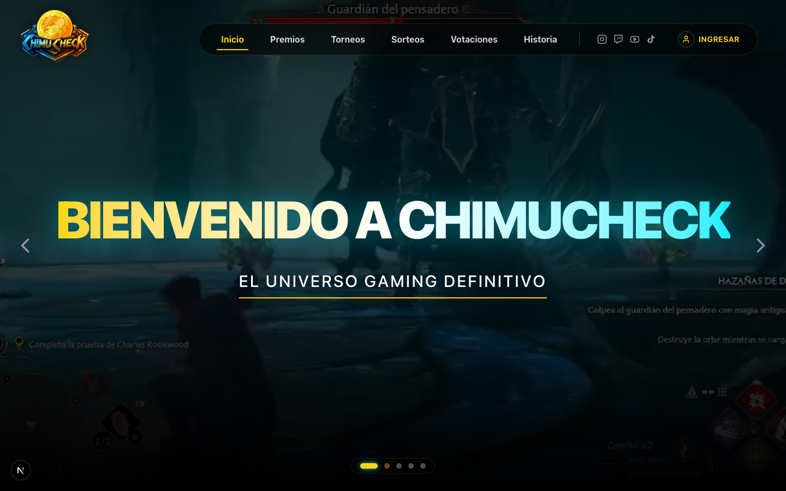

#### 2. Cartelera y Detalle de Torneos Oficiales
> Vista de competencias activas, formato de enfrentamiento (1v1, equipos), cupos y fechas de inicio.
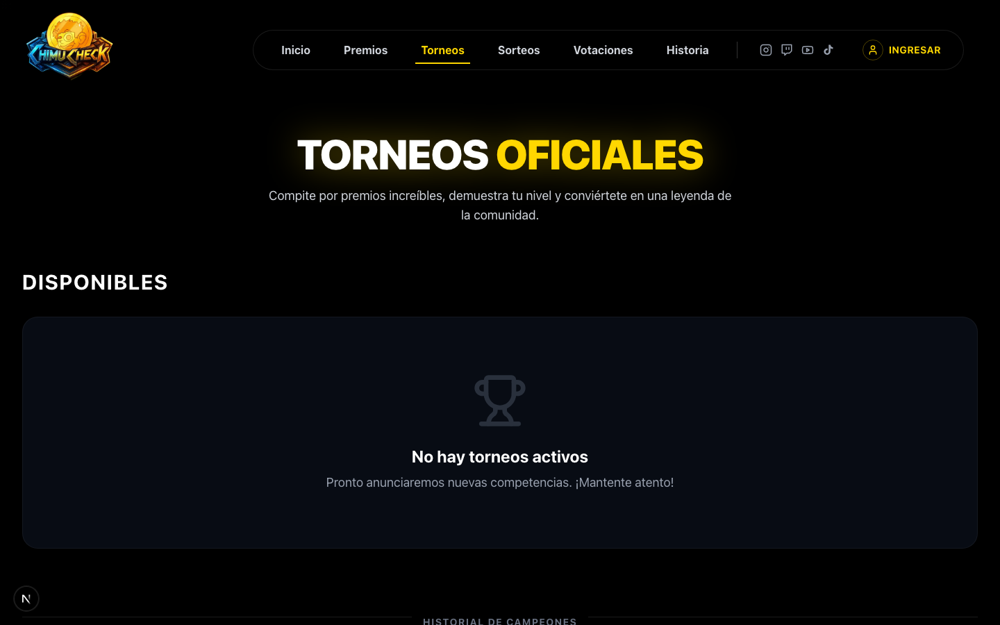
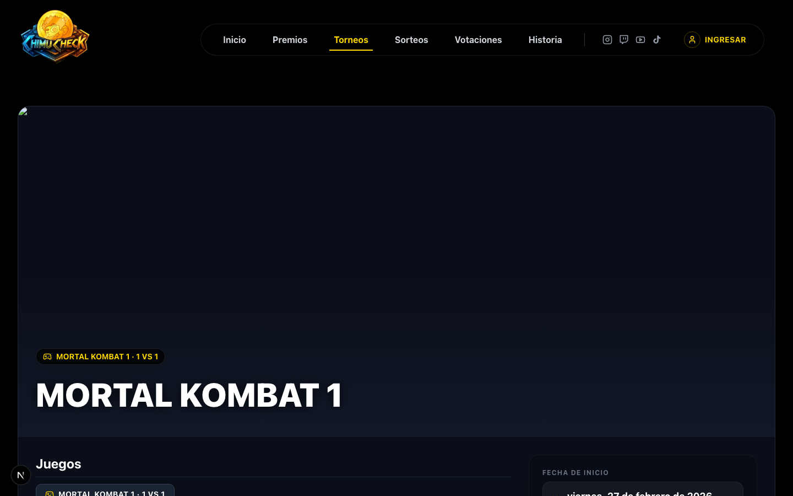

#### 3. Sorteos y Premios por Puestos
> Sorteos con galería multimedia, especificación de premios para cada puesto (1º, 2º, 3º, etc.) y botón de inscripción directa.
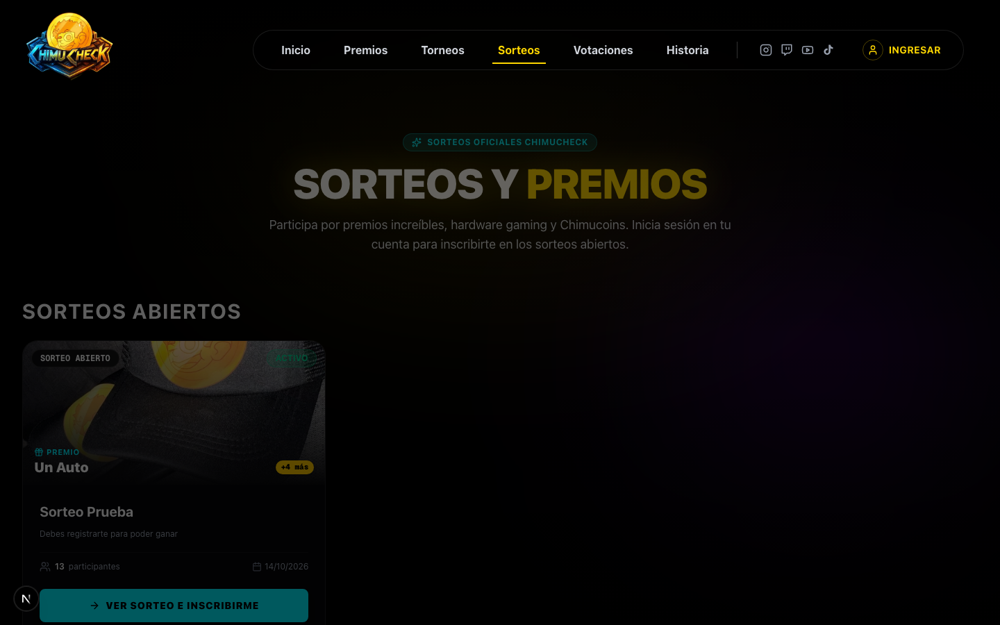
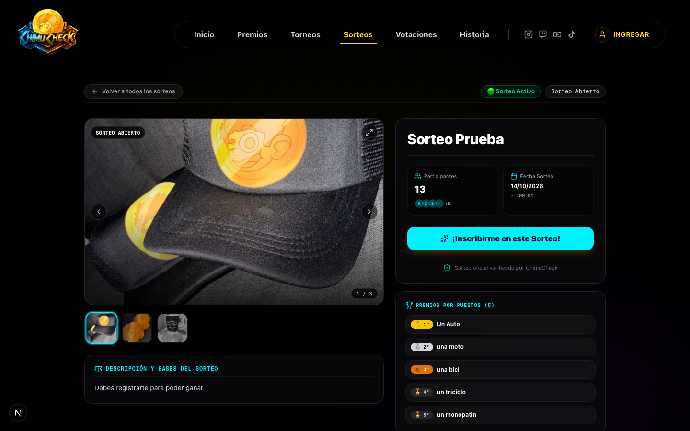

#### 4. Tienda de Recompensas y Canje de ChimuCoins
> Catálogo de productos exclusivos canjeables por esfuerzo y victorias dentro de la plataforma.
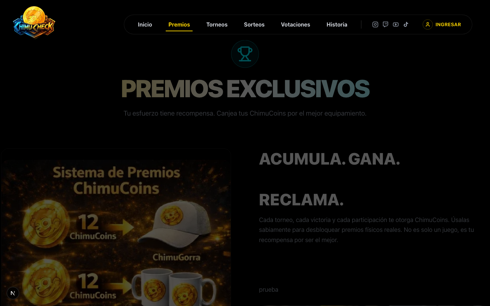

#### 5. Concursos de Votación Comunitaria
> Espacio participativo donde los usuarios votan por sus creadores y propuestas favoritas.
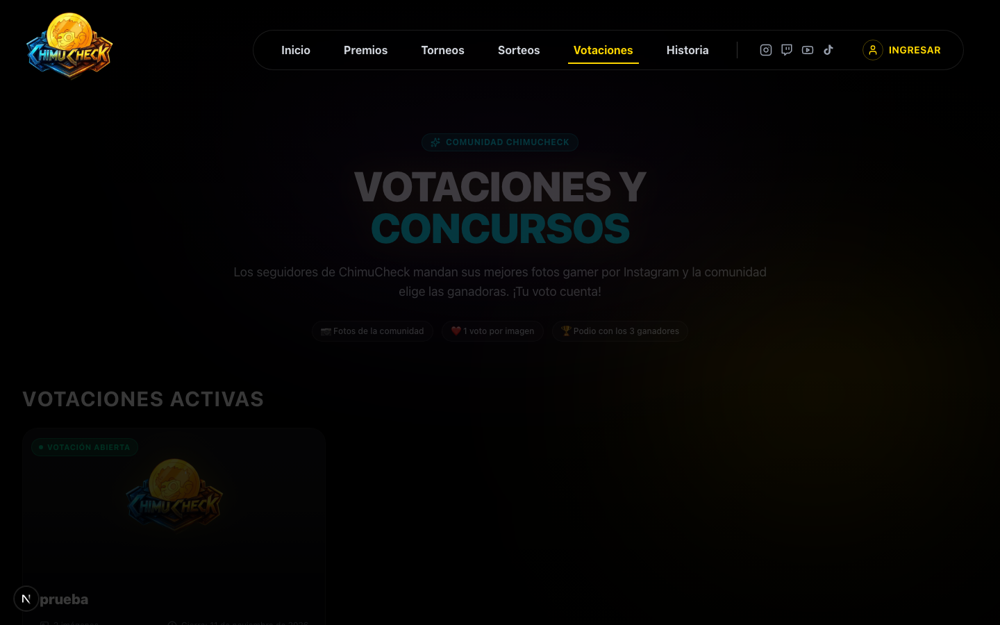

#### 6. Autenticación Social de Jugadores
> Acceso seguro y rápido mediante credenciales o inicio social OAuth (Google, X, Facebook).
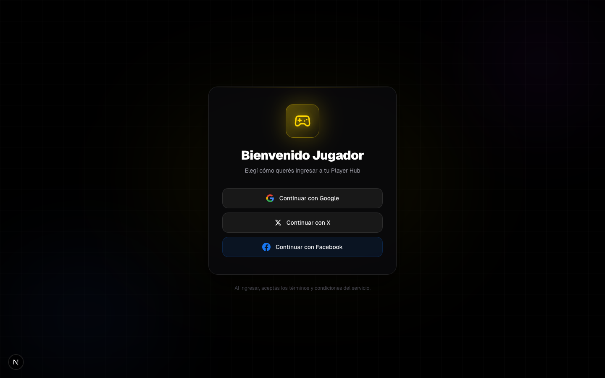

#### 7. Sección Historia / Creador
> Sección biográfica y de comunidad inspirada en el fundador con métricas de seguidores y torneos realizados.
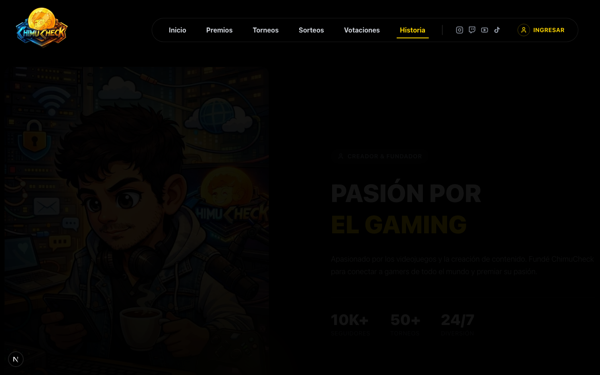

---

### 🛡️ Panel de Super Administrador

#### 8. Dashboard Central con Métricas
> Resumen de usuarios activos, torneos, ChimuCoins en circulación y gráficos de crecimiento.
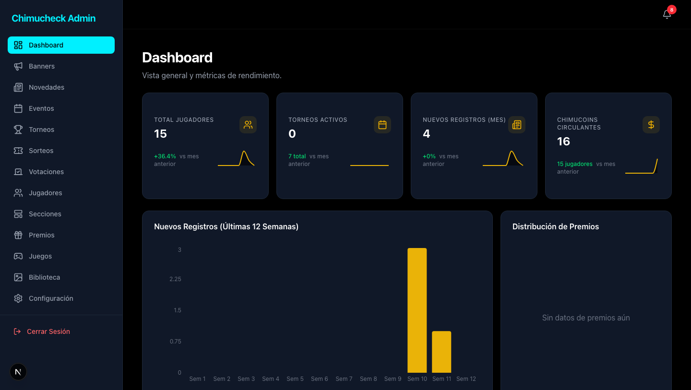

#### 9. Gestión de Sorteos y Ganadores
> Control de estados (DRAFT, ACTIVO, FINALIZADO), modo de sorteo en vivo y configuración de tiempos de espera para ganadores.
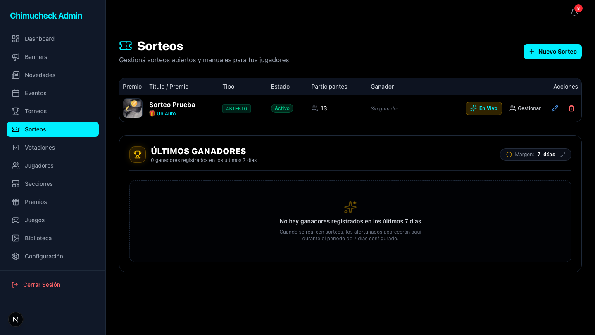

#### 10. Moderación y Gestión de Jugadores
> Lista completa de usuarios, saldos de monedas virtuales, fecha de registro y acciones administrativas rápidas.
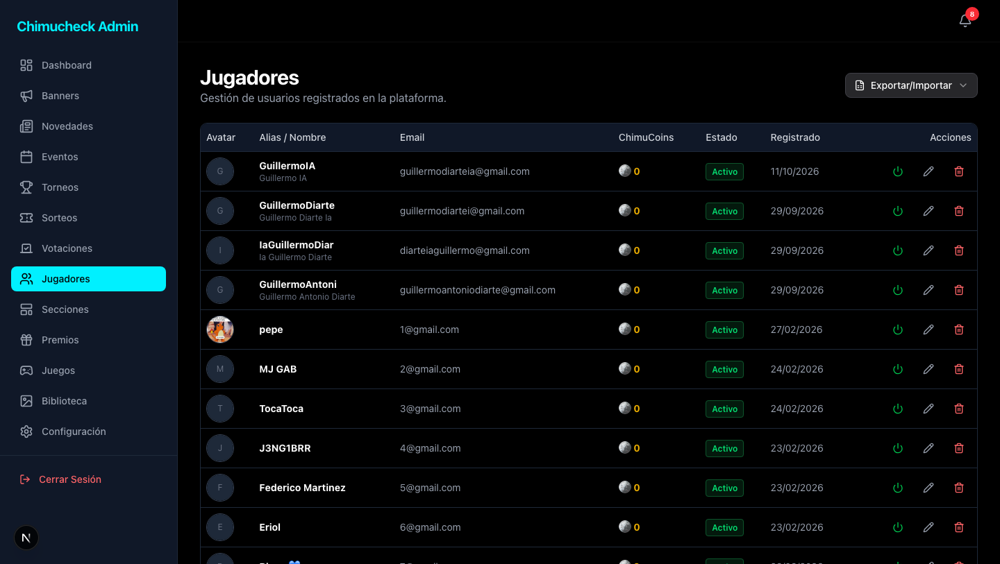

---

## 🛠️ Arquitectura y Stack Tecnológico

La solución fue desarrollada bajo una arquitectura full-stack moderna, priorizando rendimiento de renderizado, tipado estricto y experiencia de usuario fluida:

- **Framework:** [Next.js 16 (App Router)](https://nextjs.org/) con React 19 Server Components y Server Actions para mutaciones sin APIs redundantes.
- **Lenguaje:** [TypeScript 5](https://www.typescriptlang.org/) para un tipado estricto y predecible en todo el modelo de datos.
- **Estilos & UI:** [Tailwind CSS v4](https://tailwindcss.com/) complementado con [Radix UI](https://www.radix-ui.com/) (accesibilidad wAI-ARIA) y [Lucide Icons](https://lucide.dev/).
- **Animaciones:** [Framer Motion](https://www.framer.com/motion/) y [tw-animate-css](https://github.com/) para transiciones cinemáticas.
- **Base de Datos & ORM:** [Prisma ORM](https://www.prisma.io/) con SQLite en entorno de desarrollo y soporte listo para PostgreSQL/MySQL en producción.
- **Autenticación:** [Auth.js (NextAuth v5)](https://authjs.dev/) con adaptadores para OAuth social y sesiones de administración basadas en cookies `httpOnly`.
- **Métricas & Visualización:** [Recharts](https://recharts.org/) para visualización interactiva de registros y estadísticas.
- **Optimización de Medios:** [Sharp](https://sharp.pixelplumbing.com/) para conversión y compresión automática a formato `.webp`.

---

## 🚀 Guía de Instalación y Ejecución Local

Sigue estos sencillos pasos para tener una instancia completa de ChimuCheck ejecutándose en tu máquina:

### 1. Prerrequisitos
- **Node.js:** Versión `20.9.0` o superior instalada ([Descargar Node](https://nodejs.org/)).
- **npm** (incluido con Node) o **pnpm**.
- **Git** instalado.

### 2. Clonar el Repositorio
```bash
git clone https://github.com/guillermodiarte/Chimucheck.git
cd Chimucheck
```

### 3. Instalar Dependencias
```bash
npm install
```

### 4. Configurar Variables de Entorno
Copia el archivo de ejemplo y genera tu archivo `.env`:
```bash
cp .env.example .env
```
*(Para pruebas locales, los valores predeterminados de base de datos SQLite y `AUTH_SECRET` funcionan inmediatamente)*.

### 5. Preparar la Base de Datos
Genera el cliente de Prisma, sincroniza las tablas y ejecuta el seed inicial:
```bash
# Sincronizar el esquema con la base de datos local
npx prisma db push

# Cargar datos iniciales (banners, usuario administrador, noticias y eventos de muestra)
node prisma/seed.js
```

### 6. Iniciar el Servidor de Desarrollo
```bash
npm run dev
```

Abre tu navegador en [http://localhost:3000](http://localhost:3000) para acceder a la plataforma.

### 🔑 Credenciales de Prueba (Super Admin)
- **URL Admin:** [http://localhost:3000/admin](http://localhost:3000/admin)
- **Email:** `admin@chimucheck.com`
- **Contraseña:** `admin123`

---

## 🐳 Despliegue con Docker

El proyecto incluye soporte completo para Docker y Docker Compose para despliegues contenerizados:

```bash
# Construir e iniciar contenedores en segundo plano
docker compose up -d --build

# Ver logs del contenedor
docker compose logs -f

# Detener los contenedores
docker compose down
```

---

## 🔐 Variables de Entorno

Asegúrate de configurar las siguientes variables en tu archivo `.env` según tu entorno:

```env
# Conexión de Base de Datos
DATABASE_URL="file:./dev.db"

# Autenticación NextAuth / Auth.js
AUTH_SECRET="tu_clave_secreta_super_segura"
NEXTAUTH_URL="http://localhost:3000"

# Proveedores OAuth (Opcional para Login Social)
AUTH_GOOGLE_ID="tu-google-client-id"
AUTH_GOOGLE_SECRET="tu-google-client-secret"

AUTH_DISCORD_ID="tu-discord-client-id"
AUTH_DISCORD_SECRET="tu-discord-client-secret"

AUTH_TWITCH_ID="tu-twitch-client-id"
AUTH_TWITCH_SECRET="tu-twitch-client-secret"

AUTH_TWITTER_ID="tu-twitter-client-id"
AUTH_TWITTER_SECRET="tu-twitter-client-secret"

AUTH_FACEBOOK_ID="tu-facebook-client-id"
AUTH_FACEBOOK_SECRET="tu-facebook-client-secret"
```

---

## 👨‍💻 Autor y Contacto

Desarrollado con dedicación como pieza central de cartera de desarrollo y ecosistema de entretenimiento gaming:

- **Desarrollador:** Guillermo Diarte
- **Repositorio:** [github.com/guillermodiarte/Chimucheck](https://github.com/guillermodiarte/Chimucheck)
- **Licencia:** Proyecto Privado / Todos los derechos reservados.
